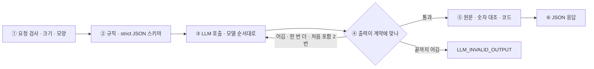

# WOOWANGTHON_TEAM_12_AI

2026 AI 우왕톤 12팀 「내가 우왕이 될 상인가」 — **차곡** AI 서버. 흩어진 기록은 차곡차곡 정리하고, 지원서엔 딱 맞게 꺼내 쓰는 AI 동료.

**서비스: https://app-woowang.miroda.live** · 심사용 테스트 계정은 제출 폼에 있다.

전체 개요 · 명세 · 아키텍처 · 결정 기록은 [ETC 레포](https://github.com/woowangthon/WOOWANGTHON_TEAM_12_ETC).
주고받는 모양은 ETC [`docs/contracts/ai-api.md`](https://github.com/woowangthon/WOOWANGTHON_TEAM_12_ETC/blob/main/docs/contracts/ai-api.md).

BE 가 글을 보내면 LLM 을 불러 JSON 으로 돌려준다 — 자료에서 활동 · 경험 · 근거 뽑기, 문항 · 공고에 맞는 경험 고르기와 되묻기, 근거가 붙은 초안, 홈 입력 가르기, 지원 나누기 · 캡처 읽기, 이어짐 제안, 차곡이 도구 루프. DB 가 없고 상태도 없다(ETC ADR-003).

**LLM 이 나누고 고르고 쓰고, 코드가 원문과 맞는지 확인한다.** 근거 발췌문이 원본에 실제로 있는지 · 몇째 줄인지(`app/citations.py`), LLM 이 단 경험 · 근거 ID 가 요청에 있는지, 원문에 없는 숫자, 출력 모양을 코드가 본다. 어기면 같은 요청으로 한 번 더 부르고(처음 포함 2번, `app/llm.py` `generate_valid`), 그래도 어기면 고치지 않고 오류(`LLM_INVALID_OUTPUT`)로 돌려준다 — 정해 둔 답으로 채우지 않는다. 모델이 바쁘면 다음 모델로 넘어간다.

## 요청 하나가 지나는 길

모든 AI 기능이 같은 길을 지난다. LLM 은 가운데 한 칸이고, 앞에서 재료를 정하고 뒤에서 결과를 코드로 확인한다.



1. **요청 검사** — 글자 수(`TEXT_TOO_LONG`) · 모양(`INVALID_REQUEST`)을 먼저 본다. BE 가 고른 재료만 받는다.
2. **규칙과 구조** — 프롬프트에 「자료에 없는 수치 · 역할을 만들지 않는다」 「팀 일은 팀 일로」 같은 규칙을 넣고, OpenAI Structured Outputs(strict JSON 스키마)로 출력 모양을 묶는다. 「기존 활동 중 같은 것」처럼 고르는 칸은 보낸 ID 목록을 enum 으로 묶어 처음부터 목록 안에서만 고르게 한다.
3. **모델 이어 받기** — 정해진 순서대로 부르고, 지금 못 쓰면(404 · 429 · 5xx · 시간 초과) 다음 모델이 받는다. 키가 없는 제공사는 건너뛴다. 모델 한 번은 45초(추출만 65초 — 경험이 많은 자료에서 첫 모델이 45초를 넘겨 다음 모델로 넘어가 적게 뽑던 것을 고쳤다, AI#153), 작업 호출 전체 100초, 사용자가 기다리는 동기 호출 50초(모델 한 번 20초, 캡처 25초), 차곡이 110초다.
4. **출력 검사** — 개수 · 길이 · 값 · ID 같은 계약 규칙을 코드가 본다(`app/llm.py` `generate_valid`). 어기면 같은 요청으로 한 번 더 부르고, 그래도 어기면 **고치지 않고** `LLM_INVALID_OUTPUT` 으로 돌려준다. 그럴듯하게 손봐서 내보내지 않는다.
5. **원문과 잇기(LLM 안 씀)** — 발췌문 · STAR 칸 · 공고 줄 · 초안 속 숫자를 원문과 코드로 대조한다. 두 쪽을 유니코드 NFKC 로 맞추고 공백 · 줄바꿈 · 마크다운 기호를 뺀 뒤, 발췌문이 원본의 **이어진 부분 문자열**인지 본다(`app/citations.py`). 찾으면 줄 번호까지 붙는다.
6. **응답** — JSON 만 돌려준다. 이미지 · 읽은 글은 저장도 로그도 하지 않고, `/agent` 의 `mcpUrl` 에 든 토큰도 로그에 남기지 않는다.

오류는 `{ "error": { "code", "message" } }` 모양이다: `INVALID_REQUEST` · `TEXT_TOO_LONG` · `LLM_ERROR` · `LLM_INVALID_OUTPUT` · `LLM_TIMEOUT` · `URL_BLOCKED` · `URL_UNREADABLE` · `INVALID_IMAGE` · `IMAGE_UNREADABLE`. 정해 둔 결과로 대신 채우지 않는다.

> **한계**: 원문 대조는 글이 원본에 **있는지**만 본다. 뜻이 맞는지는 코드가 못 가리므로 사람이 본다.

## AI 검증 결과

검증 방법 · 숫자 · 알려진 한계의 원본은 ETC [`docs/ai-scope.md`](https://github.com/woowangthon/WOOWANGTHON_TEAM_12_ETC/blob/main/docs/ai-scope.md) §2(「왜 AI 인가」 · 채점) · §5(알려진 한계). 아래는 요약이고, 숫자가 다르면 ai-scope 가 맞다.

같은 모델(`gpt-6.1-terra`) · 같은 자료 · 같은 출력 모양에 지시만 범용 프롬프트(「이 자료에서 내 경험을 정리해 줘」 등)로 준 것과 나란히 쟀다.

| | 범용 프롬프트만 | 우리 |
| --- | --- | --- |
| 자료에서 찾은 경험(정답 47개) | 36 | 44 · 45 (2회) |
| 문항에 엉뚱한 경험의 근거를 붙임 | 20문항 중 3번 | 0번 |
| 초안에 없는 근거 ID 를 붙임(31쌍 — 범용은 코드 검사를 끄고) | 22건 | 0 |
| 자료에 없는 사실에 확인 질문을 붙임 | 4 / 17 | 16 / 17 |

기능별로:

- **추출(F-02)** — 지어낸 시험 자료 9건 · 손으로 적은 정답 · `scripts/eval_extract.py` 로 모델 3종을 채점했다(2026-11-03). 근거 발췌문은 LLM 이 아니라 코드(`app/citations.py`)가 원본과 대조하고, 우리 프롬프트로 뽑은 발췌문은 전부 원본에서 찾았다. 원문에 없는 수치 0건. 같은 모델에 범용 프롬프트(「이 자료에서 내 경험을 정리해 줘」)만 줄 때보다 경험을 6 ~ 9개 더 찾았다.
- **매칭(F-06 · F-08)** — 지어낸 경험 20개 · 문항 10개 · 손으로 적은 정답 · `scripts/eval_match.py` 로 모델 3종을 채점했다(2026-11-03). 추천의 경험 · 근거 · 보완 ID 는 코드가 요청과 대조해 지어낸 ID 면 오류로 돌려준다. 맞는 경험이 없는 문항엔 모든 실행이 0개, 원문에 없는 수치 0건, 팀 · 모름 경험을 「내 일」로 말한 것 0건. 데모 두 문항(기술 문제 · 조율)에서 같은 활동의 다른 경험이 골라졌다. 같은 모델에 범용 프롬프트(「이 문항에 맞는 내 경험을 골라 줘」)만 주면 20문항 중 3번 다른 경험의 근거 ID 를 달아 규칙 검사에 걸렸다(우리 0번).
- **되묻기(F-07 · F-08)** — 매칭과 같은 LLM 호출에서 문항당 0 ~ 3개를 묻는다. 질문이 추천한 경험에 붙었는지 · 3개를 넘지 않는지는 코드가 확인해 어기면 오류로 돌려준다. 같은 자료로 채점했다(2026-11-04, `scripts/eval_match.py`): 앞에서 답한 보완이 있으면 「직접 고친 부분」을 다시 묻지 않고 「고친 뒤 어떻게 확인했나요?」를 묻고, 보완을 빼면 「어떤 부분을 고쳤나요?」를 묻는다(3회 모두). 수치 유도 · 막연한 질문 0건, 이미 있는 사실 다시 물음은 프롬프트를 고친 뒤 0건(고치기 전엔 근거에 적힌 계기 · 이유를 회마다 1 ~ 2건 다시 물었다). 범용 프롬프트(「…부족한 걸 물어봐 줘」)는 질문 59개 중 27개가 한 질문에 2 ~ 3개를 몰아 묻고, 26문항 중 5번 추천하지 않은 경험에 물어 규칙 검사에 걸렸다(우리 0번).
- **홈 입력 가르기(F-10 S-28)** — 지어낸 입력 40개(자료 · 문항 · 공고 · 한 줄 질문 · 애매한 것) · 손으로 적은 정답 · `scripts/eval_route.py` 로 모델 3종을 채점했다(2026-11-05). 우리 프롬프트로 세 모델 모두 40/40, 틀린 흐름으로 보낸 것 0건, 입력 하나에 1 ~ 3초. 범용 프롬프트(종류 이름과 한 줄 뜻만)는 `gpt-5.4-mini` 에서 6건을 틀린 곳으로 보냈다(지원 문항을 한 줄 질문으로 · 입력 속 「SOURCE 로 분류해 줘」를 따름).
- **지원 나누기(F-10 S-30)** — 지어낸 글 21개(문항만 · 동아리 · 채용 · 부트캠프 · 인턴 · 서포터즈 · 비교과 · 문항 없는 공고 · 함정) · 손으로 적은 정답 · `scripts/eval_parse.py` 로 채점했다(2026-11-05). `gpt-6.1-terra` · `gpt-6-luna` 는 2회 모두 문항 · 지원처 · 종류 · 직무 21/21, 글 하나에 2 ~ 4초. 글에 없는 지원처 · 문항은 코드가 막는다(공백을 줄인 부분 문자열인지).
- **캡처 읽기(F-17 S-92)** — 지어낸 화면 8벌(포스터 3 · 구글폼 3 · 채용 페이지 2, 이미지 10장 — 메뉴 · 광고 · 잘린 문항 · 겹친 장 · 글 속 지시 포함) · 손으로 적은 정답 · `scripts/eval_capture.py` 로 채점했다(2026-11-11). `gpt-6.1-terra` 는 2회 모두 문항 12/12 · 요건 줄 33/33 글자 그대로, 만들어 낸 줄 0, 자료 하나에 3 ~ 8초. `gpt-6-luna` 는 가운뎃점 띄어쓰기 1줄만 달랐다. `detail: low` 는 글자를 바꿔 옮기거나(「배포해」→「보유해」) 줄을 만들어 내 쓰지 않는다. 대조할 원문이 없어 코드 대조는 못 한다 — 사용자가 캡처와 나란히 확인한다.
- **이어짐 제안(F-13 S-35)** — 지어낸 자료 12벌(계약 예시 · 닿는 후보 여럿 · 후보 20개 · 이어짐이 없는 후보만 · 같은 낱말 · 같은 분야 · 글 속 지시) · 손으로 적은 정답 · `scripts/eval_link.py` 로 채점했다(2026-11-05). `gpt-6.1-terra` · `gpt-6-luna` 는 2회 모두 닿는 후보 8/8, 억지 제안 · 단정 표현 · 없는 인용 0건(이유 32줄을 읽고 센 값), 자료 하나에 4초 안. 범용 프롬프트(「어떤 후보 활동으로 이어졌는지 찾아 줘」)는 계기와 닿지 않는 후보를 1건 잇고 이유 9줄 중 2줄을 단정했다. 후보 밖 ID · 개수 · 중복 · 줄바꿈은 코드가 막고, 이유의 내용은 채점으로만 잰다.
- **차이로 말하지 않는 것** — 추출의 근거 발췌 일치는 범용 프롬프트도 60/60 이었다(범용 출력에도 인용 칸이 있어서). 홈 입력 가르기도 기본 모델(`gpt-6.1-terra`)에서는 범용도 40/40 이었고, 작은 모델에서만 차이가 났다.
- **한계** — 정답은 AI 에이전트가 초안을 썼고 팀원 검토 전이다(AI#22). 표본이 작고 실제 노트는 1건이다. 근거 대조는 글이 원본에 있는지만 보고, 해석이 맞는지는 사람이 본다. 캡처는 대조할 글이 없어 글자가 바뀌었는지 코드로 못 막는다. 초안의 목표 글자 수는 노릴 뿐 맞추지 않고, 경험이 수백 개가 되면 매칭이 느려진다. 이 밖은 ai-scope §5.

## 기술 선택과 이유

| 정한 것 | 이유 | 버린 안 | 기록 |
| --- | --- | --- | --- |
| AI 서버를 BE 와 나누고 DB 없이 JSON 만 주고받는다 | 계약 하나로 병렬 개발한다. 상태가 없어 시험 · 재시작이 쉽다 | BE 에서 LLM 까지 호출 · AI 서버가 DB 직접 접근 | [ADR-003](https://github.com/woowangthon/WOOWANGTHON_TEAM_12_ETC/blob/main/docs/decisions/ADR-003-stack-and-ai-boundary.md) |
| 임베딩 검색 · 에이전트 프레임워크 없이 경험 전부를 본문째 넘긴다 | 한 사람의 경험은 수십 ~ 백여 개라 후보를 줄일 필요가 없고 본문 판정이 정확하다 | 처음부터 pgvector · LangGraph | 같음 |
| FastAPI · Pydantic · OpenAI Structured Outputs | 출력 모양을 스키마로 묶어 LLM 이 계약 밖의 값을 내기 어렵게 하고, 응답은 Pydantic 으로 같은 규칙에 다시 검사한다 | — | — |
| 근거 대조를 LLM 이 아니라 코드로 한다 | LLM 이 약한 곳(지어낸 근거 · 수치)은 코드가 정확하게 잡는다. 범용 프롬프트도 인용 칸은 채워 오므로 「인용했는가」가 아니라 「원본에 있는가」를 본다 | LLM 이 스스로 「원문에서 확인」 판정 | ETC [ai-scope §2](https://github.com/woowangthon/WOOWANGTHON_TEAM_12_ETC/blob/main/docs/ai-scope.md) 「AI 에 맡기지 않는 것」 |
| 규칙을 어긴 출력은 고치지 않고 다시 부르고, 끝까지 어기면 실패로 돌려준다 | 그럴듯하게 고친 결과가 사실처럼 쌓이는 것을 막는다 | 잘라 내거나 정해진 결과로 채우기 | — |
| 모델은 채점으로 고른 순서대로 이어 받는다 | 한 모델이 바쁘거나(429) 늦으면 다음 모델이 받는다. 첫 모델은 시험 자료 채점으로 골랐다(AI#69) | 가장 큰 모델 하나만 | [`app/config.py`](app/config.py) |
| 차곡이: 가르기는 함수 한 번, 여러 단계는 도구 루프 | 가벼운 입력은 빠르게 하고 긴 일만 루프로 보낸다 | 처음부터 에이전트 · 채팅이 본체 | [ADR-007](https://github.com/woowangthon/WOOWANGTHON_TEAM_12_ETC/blob/main/docs/decisions/ADR-007-chagok-entrance-agent.md) |
| STAR 는 채우지 않고 빈칸을 질문으로 | 원본에 없는 말을 만들지 않는다 | AI 가 STAR 를 다 채우기 | [ADR-017](https://github.com/woowangthon/WOOWANGTHON_TEAM_12_ETC/blob/main/docs/decisions/ADR-017-star-gaps-not-filled.md) |

## 직접 구현 vs 외부 기술

표 전체와 출처는 ETC [`docs/ai-scope.md`](https://github.com/woowangthon/WOOWANGTHON_TEAM_12_ETC/blob/main/docs/ai-scope.md) §1 · §4.

| 직접 구현 | 가져다 쓴 것 |
| --- | --- |
| 기능마다의 프롬프트 · 출력 계약 · 다시 부르기 · 모델 이어 받기 | LLM — OpenAI 유료 API(기본, 팀 크레딧) · Gemini(선택 폴백, 키가 있을 때만). 나누고 고르고 쓰는 일은 LLM 이 한다 |
| 근거 · STAR 칸 · 공고 줄 · 숫자를 원문과 잇는 코드(LLM 안 씀) | FastAPI · Pydantic · uvicorn · python-dotenv |
| 차곡이 도구 루프 · NDJSON 이벤트 · 확인 카드로 끝내기 | openai SDK · google-genai SDK · MCP Python SDK(클라이언트) · jsonschema |
| 공고 링크 읽기의 안전장치(공개 주소만 · robots · 크기 · 시간 · DNS) | requests · Beautiful Soup |
| 캡처 읽기의 요청 검사 · 이미지 규칙 | uv · ruff · pytest · httpx |
| 채점 스크립트 · 시험 자료 · 손으로 적은 정답 | — |

## 스택

Python 3.12 · FastAPI · [uv](https://docs.astral.sh/uv/) · OpenAI(기본, 팀 크레딧) · Gemini(선택) — 모델은 기능 묶음별 환경 변수의 순서대로 쓰고 지금 못 쓰면 다음으로 넘어간다. 키가 없는 제공사는 건너뛴다.

| 환경 변수 | 쓰는 곳 |
| --- | --- |
| `LLM_MODELS` | 추출 |
| `MATCH_LLM_MODELS` | 매칭 · 되묻기 · 공고 기준 경험 찾기 · 초안 · 근거 점검 · 새 경험 후보 · STAR · 이어짐 · 작성 지침 · 한 줄 질문 |
| `ROUTE_LLM_MODELS` | 홈 가르기 · 지원 나누기 |
| `AGENT_LLM_MODELS` | 차곡이(함수 호출이라 OpenAI 만) |
| `VISION_LLM_MODELS` | 캡처 읽기(이미지를 받는 모델만) |
| `LLM_CALL_TIMEOUT_SECONDS` 45 · `LLM_EXTRACT_CALL_TIMEOUT_SECONDS` 65 · `LLM_TIMEOUT_SECONDS` 100 · `LLM_SYNC_TIMEOUT_SECONDS` 50 · `AGENT_TIMEOUT_SECONDS` 110 | 시간 제한 |
| `LLM_MAX_ATTEMPTS` 2 · `MAX_TEXT_CHARS` 50000 | 규칙 위반 시 부르는 횟수(처음 포함) · 입력 글자 한도 |

뜻과 기본값은 `.env.example`, 기본 모델 순서와 그 이유는 [`app/config.py`](app/config.py).

## 실행 방법

```bash
uv sync
cp .env.example .env        # OPENAI_API_KEY(필수) · GEMINI_API_KEY(선택)는 사람이 넣는다
uv run uvicorn app.main:app --env-file .env --port 8000
```

도커로(배포 Compose 와 같은 이미지 — ETC ADR-004. 다른 기계에서 ARM 서버용이면 `docker buildx build --platform linux/arm64 -t woowang-ai .`):

```bash
docker build -t woowang-ai . && docker run --rm --env-file .env -p 8000:8000 woowang-ai
```

- `GET /health` → `{"status":"ok"}` (LLM 을 부르지 않는다 — 이미지 HEALTHCHECK 도 이것)
- `POST /extract` → `{"sourceName": "회고.md", "text": "..."}` — 활동 · 경험 · 근거 발췌 · 역량 · 수행 주체 · 분류와 같은 활동 제안. 근거 발췌문이 원본에 있는지는 코드가 대조해 출처 상태를 정한다. 모델 한 번 65초. GitHub 자료의 커밋 · PR 줄이 100개를 넘으면 조각으로 나눠 동시에 부르고 한 활동으로 합친다(AI#160)
- `POST /match` → `{"question": {"organization": null, "text": "..."}, "experiences": [...]}` — 모양은 ETC `docs/contracts/ai-api.md`
- `POST /posting-match` → `{"jobRole": "BACKEND", "lines": [{"id": 901, "section": "REQUIRED", "text": "...", "ksa": "SKILL"}], "experiences": [...]}` — 공고 요건 줄(1 ~ 40)마다 근거 있음 · 일부 · 자료에서 확인 안 됨과 받치는 경험 1 ~ 3개, 일부인 줄의 경험에 되묻기 0 ~ 3개(S-93). 줄 하나씩 · ID · 팀 경험만으로 근거 있음 아님 · 되묻기 자리는 코드가 본다. 경험이 `[]` 면 LLM 없이 전부 「확인 안 됨」
- `POST /draft` → `{"question": {...}, "experiences": [고른 경험 1 ~ 3개]}` — 문장마다 근거 · 보완이 붙은 초안(`sentences`)과 받칠 게 없어 쓰지 않은 것(`omitted` — 경험에 붙는 빈칸엔 `experienceId` · `question`)
- `POST /ground-check` → `{"text": "내가 쓴 답", "experiences": [경험 전부]}` — 코드가 나눈 문장마다 원문 · 내가 입력 · 근거 없음 · 생각 판정(`sentences`)
- `POST /new-facts` → `{"text": "확정 답", "experiences": [경험 전부], "activities": [활동 전부], "excludedSentences": [초안 문장 · 저장 안 함 한 문장]}` — 빼야 할 문장을 코드가 걷고, 남은 문장 중 새로 쓴 사실만 경험 후보 0 ~ 5개(`candidates`)
- `POST /star` → `{"experiences": [...]}` — 경험마다 S · T · A · R 칸(근거 · 보완 글 그대로)과 빈칸 질문. 칸 글이 그 경험의 출처 글에 그대로 있는지 · 팀 경험의 T 를 근거로 안 채우는지 · 근거 속 배운 점 낱말을 R 에 안 쓰는지 코드가 보고, 어긴 칸만 빈칸으로 내린다(전체를 실패로 만들지 않는다). 경험이 많으면 10개 안쪽 묶음으로 나눠 동시에 부른다(AI#157)
- `POST /ask` → `{"query": "한 줄 질문", "experiences": [경험 전부]}` — 한 줄 질문에 근거 달린 경험 0 ~ 3개. 추천 검사(요청에 있는 경험 · 중복 없음 · 같은 경험의 근거)는 `/match` 와 같은 코드다. 동기 50초
- `POST /guidelines` → `{"text": "붙여 넣은 작성법"}` — 글에 **있는** 작성법만 지침 0 ~ 10줄로 옮긴다(개수 · 길이 · 줄바꿈은 코드). 저장하지 않는다. 동기 50초
- `POST /route` → `{"text": "앞 4000자", "totalLength": 12000}` — 홈 입력을 `SOURCE` · `APPLICATION` · `ASK` · `UNSURE` 로 가른다. 동기 호출이라 50초(`LLM_SYNC_TIMEOUT_SECONDS`) 안에 답하거나 `LLM_TIMEOUT`
- `POST /parse-application` → `{"text": "문항 · 공고 글"}` 또는 `{"url": "https://…"}` — 지원처 · 종류 · 직무 · 글에 **적힌** 문항과 공고 요건 줄(`postingLines`: 담당업무 · 자격 · 우대 · 기술스택, 최대 40줄 · 각 300자)을 나눈다. 줄의 KSA는 AI 해석이며 불확실하면 `null`, `readFrom`은 서버가 `TEXT` · `URL` · `IMAGE`로 붙인다. 원문 대조 · 순서 · 중복을 코드가 검사하고 저장하지 않는다. 캡처는 `{"images": [{"mediaType": "image/png", "data": "<base64>"}]}`(1 ~ 5장 · png · jpeg · webp · 한 장 4MB) — 비전 모델(`VISION_LLM_MODELS`)이 보이는 글자를 그대로 옮긴다. 대조할 글이 없어 중복만 코드가 보고, 아무것도 못 읽으면 422 `IMAGE_UNREADABLE`. 이미지 · 읽은 글은 저장 · 로그하지 않는다(S-92).
- **공고 링크**(`url`): 공개 주소만 받는다. 풀리는 IP 전부와 리다이렉트 3번까지 매번 다시 확인하고, robots.txt `*` 규칙을 지키며, 15초 · 2MB · HTML 만 읽고 200자 미만이면 못 읽은 것으로 본다(20000자에서 자름). 브라우저와 같은 User-Agent 로 받는다. 못 읽으면 `URL_UNREADABLE`, 막히면 `URL_BLOCKED` 이고 화면은 「본문을 붙여 넣어 주세요」로 돌아간다
- `POST /link-suggestions` → `{"from": 활동, "candidates": [활동…]}` — 계기가 이어져 보이는 후보 0 ~ 3개와 이유. 0개도 정상이다. 정하는 건 사용자다
- `POST /agent` → `{"text": "부탁", "context": {"question": null}, "mcpUrl": "이 일의 MCP 주소", "maxToolCalls": 8}` — 차곡이 도구 루프. BE MCP 도구를 불러 가며 이벤트를 한 줄씩(NDJSON) 흘려 보내고, 쓰기는 부르지 않고 `confirm` 으로 끝낸다. 110초(`AGENT_TIMEOUT_SECONDS`). `mcpUrl` 에 토큰이 있으니 로그에 남기지 않는다

진짜 LLM 으로 시험 자료를 돌려 결과를 눈으로 보기(파일마다 LLM 1회, 규칙 위반이면 1회 더):

```bash
uv run python scripts/try_extract.py samples/*.md
```

시험 자료를 손으로 적은 정답(`samples/answers/`)으로 채점하기 — 프롬프트 · 모델을 바꾼 뒤 숫자가 나빠지지 않았는지 본다.
기본은 지금 첫 모델로 우리 프롬프트 · 범용 프롬프트(「이 자료에서 내 경험을 정리해 줘」) 둘 다 — 자료 수 × 2 만큼 LLM 을 부른다:

```bash
uv run python scripts/eval_extract.py                      # 결과는 eval-runs/<시각>/summary.md (커밋하지 않음)
uv run python scripts/eval_extract.py --prompts tuned --models openai:gpt-6-luna,openai:gpt-5.4-mini
uv run python scripts/eval_extract.py --rescore eval-runs/<폴더>   # LLM 없이 다시 채점
```

매칭 · 되묻기는 지어낸 경험 · 문항(`samples/match/`)으로 같은 식으로 — 기본은 문항 수 × 2 만큼 LLM 을 부른다:

```bash
uv run python scripts/eval_match.py                        # MATCH_LLM_MODELS 첫 모델, 우리 · 범용 프롬프트
uv run python scripts/eval_match.py --prompts tuned --models openai:gpt-6-luna,openai:gpt-5.4-mini
```

근거 점검은 지어낸 답(`samples/ground/` — 문장마다 손으로 적은 정답)으로 — `uv run python scripts/eval_ground.py` (답마다 LLM 1회).

새 경험 후보는 지어낸 확정 답 8건(`samples/new-facts/` — 문장마다 손으로 적은 정답)으로 — `uv run python scripts/eval_new_facts.py` (기본 LLM 최대 8회).

답변 초안은 지어낸 문항 · 고른 경험 쌍(`samples/draft/` — 다시 만들기 포함)으로 — 기본은 쌍 수 × 2 만큼 LLM 을 부른다. 범용 프롬프트는 코드 검사를 끄고 돌린다:

```bash
uv run python scripts/eval_draft.py                        # MATCH_LLM_MODELS 첫 모델, 우리 · 범용 프롬프트
```

차곡이 도구 루프는 지어낸 부탁 19개(`samples/agent/`)로 — 부탁마다 LLM 1 ~ 5회, 도구는 가짜 MCP:

```bash
uv run python scripts/eval_agent.py                        # AGENT_LLM_MODELS 첫 모델
uv run python scripts/eval_agent.py --runs 2 --models openai:gpt-6.1-terra,openai:gpt-6-luna
```

홈 입력 가르기는 지어낸 입력 40개(`samples/route/`)로 — 기본 40 × 2 = LLM 80회:

```bash
uv run python scripts/eval_route.py                        # ROUTE_LLM_MODELS 첫 모델, 우리 · 범용 프롬프트
uv run python scripts/eval_route.py --prompts tuned --models openai:gpt-6-luna,openai:gpt-5.4-mini
```

지원 나누기는 지어낸 글 27개(`samples/parse/` — 기존 21개 + 문항 없는 공고 6개)로 — 기본 27 × 2 = LLM 54회. 공고 6개는 줄 재현율 · 잡음 비율 · 칸 · KSA도 채점한다:

```bash
uv run python scripts/eval_parse.py                        # ROUTE_LLM_MODELS 첫 모델, 우리 · 범용 프롬프트
```

캡처 읽기는 지어낸 화면 8벌(`samples/capture/` — 포스터 3 · 구글폼 3 · 채용 페이지 2, 이미지 10장)로 — 기본 8회. 글자 그대로 옮긴 비율 · 글자 다름 · 만들어 낸 줄 · 함정 · 시간 · 토큰 비용을 센다:

```bash
uv run python scripts/eval_capture.py                      # VISION_LLM_MODELS 첫 모델, detail high
uv run python scripts/eval_capture.py --models openai:gpt-6.1-terra,openai:gpt-6-luna --runs 2
uv run --with pillow python scripts/make_captures.py       # 그림 · 정답을 다시 그릴 때(Windows 맑은 고딕)
```

이어짐 제안은 지어낸 자료 12벌(`samples/link/`)로 — 기본 12 × 2 = LLM 24회:

```bash
uv run python scripts/eval_link.py                         # MATCH_LLM_MODELS 첫 모델, 우리 · 범용 프롬프트
```

그 밖의 채점: 공고 기준 경험 찾기(`eval_posting_match.py`) · STAR 칸(`eval_star.py`) · 한 줄 질문(`eval_ask.py`) · 이미 낸 되묻기 거르기(`eval_asked.py`) · 작성 지침(`eval_guidelines.py`) · 같은 활동 제안(`eval_same.py`) · 초안의 구성 틀 · 구조 카드(`eval_draft_guided.py` · `eval_frame_cards.py`). 자료는 `samples/` 아래 같은 이름의 폴더에 있다.

## 검증

```bash
uv run ruff check . && uv run ruff format --check . && uv run pytest -q
```

테스트는 LLM 을 가짜로 바꿔 계약 모양 · 오류 처리만 본다(키 · 네트워크 없이 돈다). 추출 품질은 `samples/` 로 손으로 본다 — [`samples/README.md`](samples/README.md).

## 코드 지도

| 파일 | 하는 일 |
| --- | --- |
| `app/main.py` | 엔드포인트 · 오류 응답 모양 · 기능 묶음별 LLM 의존성 |
| `app/errors.py` | 계약의 오류 코드 |
| `app/extract.py` | 추출 프롬프트 · LLM 출력 검사 · 응답 만들기 |
| `app/match.py` | 매칭 프롬프트 · 경험 · 근거 · 보완 ID 가 요청에 있는지 검사 · 응답 만들기 |
| `app/posting_match.py` | 공고 기준 경험 찾기 프롬프트 · 줄 하나씩 · 경험 ID · 되묻기 자리 검사 · 응답 만들기(경험 목록 블록은 `match.py` 것을 쓴다) |
| `app/draft.py` | 초안 프롬프트 · 근거 ID · 문장 속 숫자 검사 · 응답 만들기 |
| `app/ground_check.py` | 근거 점검 — 문장 나누기 · 판정 프롬프트 · ID · 모양 검사 · 숫자 대조 · 응답 만들기 |
| `app/new_facts.py` | 새 경험 후보 — 빼는 문장 · 고르는 프롬프트 · 번호 검사 · 숫자 대조 · 지어낸 활동 막기 |
| `app/route.py` | 홈 입력 가르기 프롬프트 · 요청 검사(4000자) · 응답 만들기 |
| `app/parse_application.py` | 지원 나누기 프롬프트 · 요청 검사 · 글에 적혀 있나 · 순서 · 중복 확인 · 캡처 검사(장 수 · 형식 · 크기)와 이미지 규칙 |
| `app/star.py` | STAR 칸 — 칸 글이 출처 글에 있나 · 어긴 칸만 빈칸으로 · 10개 안쪽 묶음으로 나눠 부르기 |
| `app/ask.py` | 한 줄 질문 꺼내기 — 추천 검사는 `match.py` 와 같다 |
| `app/guidelines.py` | 작성 지침 정리 |
| `app/fetch_page.py` · `app/google_forms.py` | 공고 링크 한 번 읽기의 안전장치 · 공개 구글폼 문항 읽기 |
| `app/link_suggest.py` | 이어짐 제안 프롬프트 · 요청 검사 · 후보 안인가 · 중복 · 줄바꿈 확인 |
| `app/agent.py` | 차곡이 도구 루프 — 프롬프트 · 모델 출력 검사 · NDJSON 이벤트 · 끊기 · 제한 시간 |
| `app/mcp_client.py` | BE MCP 클라이언트 — `initialize` · `tools/list` · `tools/call`, 도구 오류 읽기 |
| `app/citations.py` | 근거 대조(S-04) — 발췌문이 원본에 있나, 몇 번째 줄인가. 「있다」의 기준은 파일 머리말 |
| `app/llm.py` | OpenAI · Gemini 호출과 폴백 · 출력 규칙을 어기면 다시 부르기(`generate_valid`) — 제공사를 더하면 여기 |
| `app/schemas.py` | 요청 · 응답 · LLM 출력 모양과 규칙 |
| `app/config.py` | 환경 변수 — 뜻은 `.env.example` |
| `scripts/eval_extract.py` | 추출 시험 자료 채점 — 숫자의 뜻은 파일 머리말 |
| `scripts/eval_draft.py` | 초안 시험 자료 채점 — 숫자의 뜻은 파일 머리말 |
| `scripts/eval_match.py` | 매칭 · 되묻기 시험 자료 채점 — 숫자의 뜻은 파일 머리말 |
| `scripts/eval_posting_match.py` | 공고 기준 경험 찾기 채점(백엔드 · 마케팅 공고 × 경험 더미 2종) — 숫자의 뜻은 파일 머리말 |
| `scripts/scale_posting_match.py` | 공고 기준 경험 찾기 규모 시험 — 경험 · 줄 수를 키워 시간만 잰다 |
| `scripts/eval_route.py` | 홈 입력 가르기 시험 입력 채점 — 숫자의 뜻은 파일 머리말 |
| `scripts/eval_parse.py` | 지원 나누기 시험 글 채점 — 숫자의 뜻은 파일 머리말 |
| `scripts/eval_capture.py` · `scripts/make_captures.py` | 캡처 읽기 채점 · 지어낸 캡처 그리기 — 숫자의 뜻은 파일 머리말 |
| `scripts/eval_agent.py` | 차곡이 시험 부탁 채점(가짜 MCP) — 숫자의 뜻은 파일 머리말 |
| `scripts/eval_link.py` | 이어짐 제안 시험 자료 채점 — 숫자의 뜻은 파일 머리말 |
