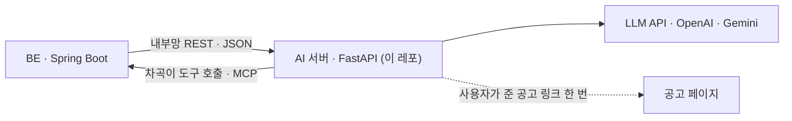
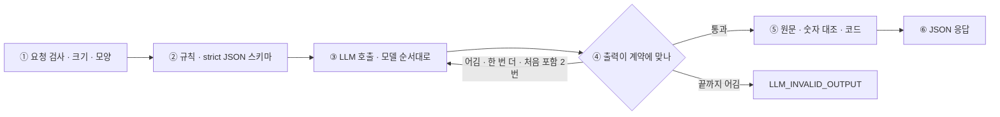

# WOOWANGTHON_TEAM_12_AI

> 차곡의 AI 서버 — LLM 을 부르고, 출력이 약속(계약)에 맞는지 검사하고, 근거를 원문과 대조한다. **DB 가 없고 상태도 없다.**

2026 AI 우왕톤 12팀 「내가 우왕이 될 상인가」. 서비스 **차곡**은 흩어진 기록에서 근거 달린 경험을 쌓아 두고, 지원할 때 맞는 경험을 꺼내 부족한 사실만 묻는다. 서비스 개요 · 명세 · 결정 기록은 [ETC 레포](https://github.com/woowangthon/WOOWANGTHON_TEAM_12_ETC), 이 서버와 BE 가 주고받는 모양은 ETC [`docs/contracts/ai-api.md`](https://github.com/woowangthon/WOOWANGTHON_TEAM_12_ETC/blob/main/docs/contracts/ai-api.md).

- BE 가 보낸 JSON 만 보고 JSON 만 돌려준다. 저장 · 사용자 구분 · 하루 호출 한도는 BE 가 맡는다([ADR-003](https://github.com/woowangthon/WOOWANGTHON_TEAM_12_ETC/blob/main/docs/decisions/ADR-003-stack-and-ai-boundary.md)).
- 밖에는 공개하지 않는다. BE 만 내부망으로 부르고, LLM 키는 이 서버에만 있다([ADR-004](https://github.com/woowangthon/WOOWANGTHON_TEAM_12_ETC/blob/main/docs/decisions/ADR-004-deploy.md)).



## 요청 하나가 지나는 길

모든 AI 기능이 같은 길을 지난다. LLM 은 가운데 한 칸이고, 앞에서 재료를 정하고 뒤에서 결과를 코드로 확인한다.



1. **요청 검사** — 글자 수(`TEXT_TOO_LONG`) · 모양(`INVALID_REQUEST`)을 먼저 본다. 이 서버는 BE 가 고른 재료만 받는다.
2. **규칙과 구조** — 프롬프트에 「자료에 없는 수치 · 역할을 만들지 않는다」 「팀 일은 팀 일로」 같은 규칙을 넣고, OpenAI Structured Outputs(strict JSON 스키마)로 출력 모양을 묶는다. 「기존 활동 중 같은 것」처럼 고르는 칸은 보낸 ID 목록을 enum 으로 묶어, 처음부터 목록 안에서만 고르게 한다.
3. **모델 이어 받기** — 정해진 순서대로 부르고, 지금 못 쓰면(404 · 429 · 5xx · 시간 초과) 다음 모델이 받는다. 키가 없는 제공사는 건너뛴다. 모델 한 번 45초, 작업 호출 전체 100초, 사용자가 기다리는 동기 호출 50초(모델 한 번 20초), 차곡이 110초를 넘기지 않는다.
4. **출력 검사** — 개수 · 길이 · 값 · ID 같은 계약 규칙을 코드가 본다(`app/llm.py` `generate_valid`). 어기면 같은 요청으로 한 번 더 부르고(처음 포함 2번), 그래도 어기면 **고치지 않고** `LLM_INVALID_OUTPUT` 으로 돌려준다. 그럴듯하게 손봐서 내보내지 않는다.
5. **원문과 잇기(LLM 안 씀)** — 발췌문 · STAR 칸 · 공고 줄 · 초안 속 숫자를 원문과 코드로 대조한다. 두 쪽을 유니코드 NFKC 로 맞추고 공백 · 줄바꿈 · 마크다운 기호를 뺀 뒤, 발췌문이 원본의 **이어진 부분 문자열**인지 본다(`app/citations.py`). 찾으면 줄 번호까지 붙는다.
6. **응답** — JSON 만 돌려준다. 이미지 · 읽은 글은 저장도 로그도 하지 않고, `/agent` 의 `mcpUrl` 에 든 토큰도 로그에 남기지 않는다.

오류는 `{ "error": { "code", "message" } }` 모양이다: `INVALID_REQUEST` · `TEXT_TOO_LONG` · `LLM_ERROR` · `LLM_INVALID_OUTPUT` · `LLM_TIMEOUT` · `URL_BLOCKED` · `URL_UNREADABLE` · `INVALID_IMAGE` · `IMAGE_UNREADABLE`. 정해 둔 결과로 대신 채우지 않는다.

> **한계**: 원문 대조는 글이 원본에 **있는지**만 본다. 뜻이 맞는지는 코드가 못 가리므로 사람이 본다.

## 기능과 엔드포인트

| 엔드포인트 | 입력 → 출력 | 코드가 확인하는 것 |
| --- | --- | --- |
| `GET /health` | `{"status":"ok"}` — LLM 을 부르지 않는다(이미지 HEALTHCHECK 도 이것) | — |
| `POST /extract` | `{"sourceName", "text"}` → 활동 · 경험 · 근거 발췌 · 역량 · 수행 주체 · 분류. 같은 활동 제안도 같은 호출에서 | 발췌문이 원본에 있는지(없으면 「확인 필요」) · 출처 상태는 LLM 이 아니라 코드가 정함 · 제안 ID 가 보낸 목록 안인지 |
| `POST /match` | `{"question", "experiences"}` → 요구사항별 판정 · 경험 추천 · 이유 · 되묻기 0 ~ 3개 · 문항 유형 | 경험 · 근거 · 보완 ID 가 요청에 있는지 · 같은 경험의 것인지 · 되묻기가 추천한 경험에 붙었는지 · 3개 이하 |
| `POST /posting-match` | `{"jobRole", "lines", "experiences"}` → 공고 요건 줄(1 ~ 40)마다 근거 있음 · 일부 · 자료에서 확인 안 됨과 받치는 경험 1 ~ 3개, 일부인 줄엔 되묻기 | 줄 하나씩 · ID · 팀 경험만으로는 「근거 있음」이 아님. 경험이 `[]` 면 LLM 없이 전부 「확인 안 됨」 |
| `POST /draft` | `{"question", "experiences"(고른 1 ~ 3개)}` → 문장마다 근거 · 보완이 붙은 초안과 받칠 게 없어 쓰지 않은 것(`omitted`), 첫 줄 소제목 | 사실 문장의 근거 ID · 문장 속 숫자가 받치는 글에 있는지 · 소제목 길이 |
| `POST /ground-check` | `{"text", "experiences"}` → 코드가 나눈 문장마다 원문 · 내가 입력 · 근거 없음 · 생각 | 근거 ID · 숫자 대조(「근거 없음」은 거짓 단정이 아니라 「확인해 주세요」) |
| `POST /new-facts` | `{"text"(확정 답), "experiences", "activities", "excludedSentences"}` → 새로 쓴 사실의 경험 후보 0 ~ 5개 | 뺄 문장을 코드가 먼저 걷음 · 번호 검사 · 숫자 대조 · 지어낸 활동 막기 |
| `POST /star` | `{"experiences"}` → 경험마다 S · T · A · R 칸과 빈칸 질문 | 칸 글이 그 경험의 근거 · 보완 글에 그대로 있는지 · 팀 경험의 T 를 근거로 안 채움 · 배운 점 낱말을 R 에 안 씀. 어긴 칸만 빈칸으로 내린다(전체를 실패로 만들지 않는다) |
| `POST /route` | `{"text"(앞 4000자), "totalLength"}` → `SOURCE` · `APPLICATION` · `ASK` · `UNSURE` | 닫힌 값 넷 · 이유 200자 이하. 동기 50초 |
| `POST /ask` | `{"query", "experiences"}` → 한 줄 질문에 근거 달린 경험 0 ~ 3개 | 매칭과 같은 추천 검사(요청에 있는 경험 · 중복 없음 · 같은 경험의 근거) |
| `POST /parse-application` | `{"text"}` 또는 `{"url"}` 또는 `{"images"}`(캡처 1 ~ 5장) → 지원처 · 종류 · 직무 · 글에 **적힌** 문항 · 공고 요건 줄(최대 40줄 · 각 300자) | 문항 · 줄이 글에 적혀 있는지 · 순서 · 중복. 캡처는 대조할 글이 없어 장 수 · 형식 · 크기만 보고, 읽은 게 없으면 `IMAGE_UNREADABLE` |
| `POST /link-suggestions` | `{"from", "candidates"}` → 계기가 이어져 보이는 후보 0 ~ 3개와 이유 | 후보 안인지 · 개수 · 중복 · 줄바꿈. 0개도 정상. 정하는 건 사용자 |
| `POST /guidelines` | `{"text"}` → 붙여 넣은 작성법에서 **글에 있는 것만** 옮긴 지침 0 ~ 10줄 | 개수 · 빈 줄 · 길이 · 줄바꿈. 저장하지 않는다 |
| `POST /agent` | `{"text", "context", "mcpUrl", "maxToolCalls"}` → 차곡이 도구 루프. 이벤트를 한 줄씩(NDJSON) 흘려 보낸다 | 도구 결과 밖 숫자 · 이름 거르기 · 적히지 않은 문항 거르기 · 쓰기 도구는 부르지 않고 `confirm` 으로 끝냄 · 110초 |

- 요청 · 응답 전체 모양은 계약 `ai-api.md`. 입력 한도는 글 50000자(`MAX_TEXT_CHARS`), `/match` 는 글자 수 합 100000자.
- **`/agent`**: BE MCP 의 `tools/list` 를 LLM 함수 호출에 그대로 넘기고 `tools/call` 로 부른다. 도구를 이 서버에 따로 두지 않는다([ADR-008](https://github.com/woowangthon/WOOWANGTHON_TEAM_12_ETC/blob/main/docs/decisions/ADR-008-mcp-tools-in-be.md)). 자료 원문은 모델이 옮겨 쓰지 않고 코드가 부탁에서 잘라 넣는다.
- **공고 링크**(`url`): 공개 주소만 받는다. 풀리는 IP 전부와 리다이렉트 3번까지 매번 다시 확인하고, robots.txt `*` 규칙을 지키며, 15초 · 2MB · HTML 만 읽는다. 브라우저와 같은 User-Agent 로 받는다. 못 읽으면 `URL_UNREADABLE`, 막히면 `URL_BLOCKED` 이고 「본문을 붙여 넣어 주세요」로 돌아간다.

## 기술 선택과 이유

| 정한 것 | 이유 | 버린 안 | 기록 |
| --- | --- | --- | --- |
| AI 서버를 BE 와 나누고 DB 없이 JSON 만 주고받는다 | 계약 하나로 병렬 개발한다. 상태가 없어 시험 · 재시작이 쉽다 | BE 에서 LLM 까지 호출 · AI 서버가 DB 직접 접근 | [ADR-003](https://github.com/woowangthon/WOOWANGTHON_TEAM_12_ETC/blob/main/docs/decisions/ADR-003-stack-and-ai-boundary.md) |
| 임베딩 검색 · 에이전트 프레임워크 없이 경험 전부를 본문째 넘긴다 | 한 사람의 경험은 수십 ~ 백여 개라 후보를 줄일 필요가 없고 본문 판정이 정확하다 | 처음부터 pgvector · LangGraph | 같음 |
| FastAPI · Pydantic · OpenAI Structured Outputs | 출력 모양을 스키마로 묶어 LLM 이 계약 밖의 값을 내기 어렵게 하고, 응답은 Pydantic 으로 같은 규칙에 다시 검사한다 | — | — |
| 근거 대조를 LLM 이 아니라 코드로 한다 | LLM 이 약한 곳(지어낸 근거 · 수치)은 코드가 정확하게 잡는다. 범용 프롬프트도 인용 칸은 채워 오기 때문에 「인용했는가」가 아니라 「원본에 있는가」를 본다 | LLM 이 스스로 「원문에서 확인」 판정 | ETC [ai-scope §2](https://github.com/woowangthon/WOOWANGTHON_TEAM_12_ETC/blob/main/docs/ai-scope.md) 「AI 에 맡기지 않는 것」 |
| 규칙을 어긴 출력은 고치지 않고 다시 부르고, 끝까지 어기면 실패로 돌려준다 | 그럴듯하게 고친 결과가 사실처럼 쌓이는 것을 막는다 | 잘라 내거나 정해진 결과로 채우기 | — |
| 모델은 채점으로 고른 순서대로 이어 받는다 | 한 모델이 바쁘거나(429) 늦으면 다음 모델이 받는다. 첫 모델은 시험 자료 채점으로 골랐다(AI#69) | 가장 큰 모델 하나만 | [`app/config.py`](app/config.py) |
| 차곡이: 가르기는 함수 한 번, 여러 단계는 도구 루프 | 가벼운 입력은 빠르게 하고 긴 일만 루프로 보낸다 | 처음부터 에이전트 · 채팅이 본체 | [ADR-007](https://github.com/woowangthon/WOOWANGTHON_TEAM_12_ETC/blob/main/docs/decisions/ADR-007-chagok-entrance-agent.md) |
| STAR 는 채우지 않고 빈칸을 질문으로 | 원본에 없는 말을 만들지 않는다 | AI 가 STAR 를 다 채우기 | [ADR-017](https://github.com/woowangthon/WOOWANGTHON_TEAM_12_ETC/blob/main/docs/decisions/ADR-017-star-gaps-not-filled.md) |

## 직접 구현 vs 외부 기술

표 전체와 출처는 ETC [`docs/ai-scope.md`](https://github.com/woowangthon/WOOWANGTHON_TEAM_12_ETC/blob/main/docs/ai-scope.md) §1 · §4.

| 직접 구현 | 가져다 쓴 것 |
| --- | --- |
| 기능마다의 프롬프트 · 출력 계약 · 다시 부르기 · 모델 이어 받기 | LLM — OpenAI 유료 API(기본, 팀 크레딧) · Gemini(선택 폴백, 키가 있을 때만). 나누고 고르고 쓰는 일은 LLM 이 한다 |
| 근거 · STAR 칸 · 공고 줄 · 숫자를 원문과 잇는 코드(LLM 안 씀) | FastAPI · Pydantic · uvicorn · python-dotenv |
| 차곡이 도구 루프 · NDJSON 이벤트 · 확인 카드로 끝내기 | openai SDK · google-genai SDK · MCP Python SDK(클라이언트) · jsonschema |
| 공고 링크 읽기의 안전장치(공개 주소만 · robots · 크기 · 시간 · DNS) | requests · Beautiful Soup |
| 캡처 읽기의 요청 검사 · 이미지 규칙 | uv · ruff · pytest · httpx |
| 채점 스크립트 · 시험 자료 · 손으로 적은 정답 | — |

## AI 검증 결과

검증 방법 · 전체 숫자 · 알려진 한계의 원본은 ETC [`docs/ai-scope.md`](https://github.com/woowangthon/WOOWANGTHON_TEAM_12_ETC/blob/main/docs/ai-scope.md) §2(「왜 AI 인가」 · 채점) · §5(알려진 한계)다. **아래는 요약이고, 숫자가 다르면 ai-scope 가 맞다.**

**방법**: 기능마다 지어낸 시험 자료 + 손으로 적은 정답 + 채점 스크립트(`scripts/eval_*.py`)로 쟀다. 같은 모델에 「이 자료에서 내 경험을 정리해 줘」 같은 **범용 프롬프트만** 준 결과와 나란히 비교했다.

| 기능 | 시험 자료 · 날짜 | 우리 | 범용 프롬프트만 |
| --- | --- | --- | --- |
| 추출(F-02) | 지어낸 자료 9건 · 정답 경험 47개 · 모델 3종 · 2026-11-03 | `gpt-6.1-terra` 가 44 · 45 개 찾음. 원문에 없는 수치 0, 남의 일을 내 일로 단 것 0 | 36 개. 수치 0 |
| 매칭(F-06 · F-08) | 지어낸 경험 20개 · 문항 10개 · 2026-11-03 | 다른 경험의 근거 ID 를 붙인 것 49문항 중 0번. 맞는 경험이 없는 문항엔 모든 실행이 0개 | 20문항 중 3번(코드가 걸러 다시 부른 뒤에도 같아 오류로 끝남) |
| 되묻기(F-07) | 같은 자료 · 2026-11-04 | 앞에서 답한 사실은 다시 묻지 않음 · 수치 유도 · 막연한 질문 0건 | 질문 59개 중 27개가 한 질문에 2 ~ 3개를 몰아 묻고, 26문항 중 5번 추천하지 않은 경험에 물음 |
| 답변 초안(F-09) | 지어낸 문항 · 경험 31쌍 · `gpt-6.1-terra` · 2026-11-08 | 지어낸 근거 ID · 숫자 0, 생각 문장 위반 0, 자료에 없는 사실에 확인 질문 16 / 17 | 지어낸 근거 ID 22, 생각 문장 위반 20, 확인 질문 4 / 17(코드 검사 끔) |
| 홈 입력 가르기(S-28) | 지어낸 입력 40개 · 2026-11-05 | 세 모델 모두 40/40, 틀린 흐름으로 보낸 것 0 | `gpt-6.1-terra` 는 40/40. 작은 모델 `gpt-5.4-mini` 는 6건을 틀린 곳으로 보냄 |
| 지원 나누기(S-30) | 지어낸 글 21개 · 2026-11-05 | `gpt-6.1-terra` · `gpt-6-luna` 2회 모두 21/21 | — |
| 캡처 읽기(S-92) | 지어낸 화면 8벌(이미지 10장) · 2026-11-11 | `gpt-6.1-terra` 문항 12/12 · 요건 줄 33/33 글자 그대로 · 만들어 낸 줄 0 | — |
| 이어짐 제안(S-35) | 지어낸 자료 12벌 · 2026-11-05 | 닿는 후보 8/8 · 억지 제안 · 단정 · 없는 인용 0 | 계기와 닿지 않는 후보를 1건 이음, 이유 9줄 중 2줄을 단정 |
| 차곡이 도구 루프(S-31) | 지어낸 부탁 18개 2회씩(가짜 MCP) · AI#41 | `gpt-6.1-terra` 36/36 · 다시 부름 0 | — |

**차이로 말하지 않는 것**: 추출의 근거 발췌 일치는 범용도 60/60 이었다(범용 출력에도 인용 칸이 있어서). 홈 가르기도 기본 모델에서는 범용도 40/40 이었다.

**한계**
- 시험 자료는 **지어낸 한 사람**의 것이라 실제 자료보다 쉽다. 정답은 AI 에이전트가 초안을 쓰고 **팀원 검토 전**이다(AI#22). 표본이 작고 실제 노트는 1건이다.
- 원문 대조는 글이 원본에 있는지만 본다. 남의 일이 섞인 줄도 「원문에서 확인」이 될 수 있다. 해석이 맞는지는 사람이 본다.
- 캡처 읽기는 대조할 글이 없어 글자가 바뀌었는지 코드로 못 막는다. 사용자가 캡처와 나란히 본다.
- 초안의 목표 글자 수는 노릴 뿐 맞추지 않는다. 재료가 모자라면 지어내지 않고 짧게 끝난다.
- 경험을 전부 한 번에 넘기므로 수백 개가 되면 느려진다. 그때 후보 줄이기(임베딩)를 붙인다.
- 폴백으로 모델이 바뀌면 결과 품질이 다를 수 있다. 이 밖은 ai-scope §5.

## 스택

Python 3.12 · [FastAPI](https://fastapi.tiangolo.com) · [uv](https://docs.astral.sh/uv/) · OpenAI(기본, 팀 크레딧) · Gemini(선택). 모델은 기능 묶음별 환경 변수의 순서대로 쓰고, 지금 못 쓰면 다음으로 넘어간다. 키가 없는 제공사는 건너뛴다.

| 환경 변수 | 쓰는 곳 |
| --- | --- |
| `LLM_MODELS` | 추출 |
| `MATCH_LLM_MODELS` | 매칭 · 되묻기 · 초안 · 근거 점검 · 새 경험 후보 · 이어짐 · 작성 지침 · 한 줄 질문 · STAR |
| `ROUTE_LLM_MODELS` | 홈 가르기 · 지원 나누기 |
| `AGENT_LLM_MODELS` | 차곡이(함수 호출이라 OpenAI 만) |
| `VISION_LLM_MODELS` | 캡처 읽기(이미지를 받는 모델만) |
| `LLM_CALL_TIMEOUT_SECONDS` 45 · `LLM_TIMEOUT_SECONDS` 100 · `LLM_SYNC_TIMEOUT_SECONDS` 50 · `AGENT_TIMEOUT_SECONDS` 110 | 시간 제한 |
| `LLM_MAX_ATTEMPTS` 2 · `MAX_TEXT_CHARS` 50000 | 규칙 위반 시 부르는 횟수 · 입력 글자 한도 |

뜻과 기본값은 `.env.example`, 기본 모델 순서와 그 이유는 [`app/config.py`](app/config.py).

## 실행 방법

```bash
uv sync
cp .env.example .env        # OPENAI_API_KEY(필수) · GEMINI_API_KEY(선택)는 사람이 넣는다
uv run uvicorn app.main:app --env-file .env --port 8000
```

도커로(배포 Compose 와 같은 이미지 — ETC ADR-004. 다른 기계에서 ARM 서버용이면 `docker buildx build --platform linux/arm64 -t woowang-ai .`):

```bash
docker build -t woowang-ai . && docker run --rm --env-file .env -p 8000:8000 woowang-ai
```

- `GET /health` 로 살아 있는지 본다. LLM 을 부르지 않는다.
- 진짜 LLM 으로 시험 자료를 돌려 결과를 눈으로 보기(파일마다 LLM 1회, 규칙 위반이면 1회 더):

  ```bash
  uv run python scripts/try_extract.py samples/*.md
  ```

- BE 와 같이 띄우는 법은 BE 레포 README, 전체 순서는 ETC README 「실행 방법」.

## 검증

```bash
uv run ruff check . && uv run ruff format --check . && uv run pytest -q
```

테스트는 LLM 을 가짜로 바꿔 계약 모양 · 오류 처리만 본다(키 · 네트워크 없이 돈다). **품질은 아래 채점 스크립트로 잰다.**

### 채점 스크립트

기능마다 지어낸 시험 자료(`samples/`)와 손으로 적은 정답으로 채점한다. 프롬프트 · 모델을 바꾼 뒤 숫자가 나빠지지 않았는지 본다. 숫자의 뜻은 각 스크립트 머리말, 자료 설명은 [`samples/README.md`](samples/README.md). 실제 LLM 을 부르므로 비용이 든다. 결과는 `eval-runs/<시각>/summary.md` 에 남고 커밋하지 않는다.

| 스크립트 | 무엇을 채점하나 | 시험 자료 |
| --- | --- | --- |
| `eval_extract.py` | 추출 — 근거 일치 · 원문에 없는 수치 · 수행 주체 · 경험 찾음 | `samples/*.md` · `samples/answers/` |
| `eval_match.py` · `eval_posting_match.py` | 매칭 · 되묻기 · 공고 기준 경험 찾기 | `samples/match/` · `match-*` · `posting-match/` |
| `eval_draft.py` · `eval_draft_guided.py` · `eval_frame_cards.py` | 초안 — 근거 · 숫자 · 글 짜임 · 구성 틀 · 구조 카드 | `samples/draft/` |
| `eval_ground.py` · `eval_new_facts.py` | 근거 점검 · 새 경험 후보 | `samples/ground/` · `samples/new-facts/` |
| `eval_star.py` · `eval_asked.py` · `eval_guidelines.py` | STAR 칸 · 이미 낸 되묻기 거르기 · 작성 지침 | `samples/star/` · `asked/` · `guidelines/` |
| `eval_route.py` · `eval_parse.py` · `eval_capture.py` | 홈 가르기 · 지원 나누기 · 캡처 읽기 | `samples/route/` · `parse/` · `capture/` |
| `eval_link.py` · `eval_same.py` · `eval_ask.py` | 이어짐 제안 · 같은 활동 제안 · 한 줄 질문 | `samples/link/` · `same/` · `ask/` |
| `eval_agent.py` | 차곡이 도구 루프(가짜 MCP) | `samples/agent/` |

```bash
uv run python scripts/eval_extract.py                      # 첫 모델, 우리 프롬프트 · 범용 프롬프트 둘 다
uv run python scripts/eval_extract.py --prompts tuned --models openai:gpt-6-luna,openai:gpt-5.4-mini
uv run python scripts/eval_extract.py --rescore eval-runs/<폴더>   # LLM 없이 다시 채점
uv run python scripts/eval_match.py                        # 매칭 · 되묻기, 같은 식으로
uv run --with pillow python scripts/make_captures.py       # 캡처 그림 · 정답을 다시 그릴 때
```

## 코드 지도

| 파일 | 하는 일 |
| --- | --- |
| `app/main.py` | 엔드포인트 · 오류 응답 모양 |
| `app/errors.py` | 계약의 오류 코드 |
| `app/llm.py` | OpenAI · Gemini 호출과 폴백 · 출력 규칙을 어기면 다시 부르기(`generate_valid`) — 제공사를 더하면 여기 |
| `app/citations.py` | 근거 대조(S-04) · 숫자 대조 — 「있다」의 기준은 파일 머리말 |
| `app/extract.py` | 추출 프롬프트 · LLM 출력 검사 · 응답 만들기 |
| `app/match.py` | 매칭 프롬프트 · 경험 · 근거 · 보완 ID 가 요청에 있는지 검사 |
| `app/posting_match.py` | 공고 기준 경험 찾기 — 줄 하나씩 · 경험 ID · 되묻기 자리 검사 |
| `app/draft.py` | 초안 프롬프트 · 근거 ID · 문장 속 숫자 검사 |
| `app/ground_check.py` | 근거 점검 — 문장 나누기 · 판정 · ID · 숫자 대조 |
| `app/new_facts.py` | 새 경험 후보 — 빼는 문장 · 번호 검사 · 숫자 대조 · 지어낸 활동 막기 |
| `app/star.py` | STAR 칸 — 칸 글이 출처 글에 있는지 · 어긴 칸만 빈칸으로 |
| `app/ask.py` | 한 줄 질문 꺼내기 — 추천 검사는 `match.py` 와 같다 |
| `app/guidelines.py` | 작성 지침 정리 |
| `app/route.py` | 홈 입력 가르기 · 요청 검사(4000자) |
| `app/parse_application.py` | 지원 나누기 · 글에 적혀 있나 · 순서 · 중복 · 캡처 검사 |
| `app/fetch_page.py` · `app/google_forms.py` | 공고 링크 한 번 읽기의 안전장치 · 공개 구글폼 문항 읽기 |
| `app/link_suggest.py` | 이어짐 제안 |
| `app/agent.py` · `app/mcp_client.py` | 차곡이 도구 루프 · BE MCP 클라이언트(`initialize` · `tools/list` · `tools/call`) |
| `app/schemas.py` · `app/config.py` | 요청 · 응답 · LLM 출력 모양과 규칙 · 환경 변수 |
| `scripts/` · `samples/` | 채점 스크립트 · 지어낸 시험 자료와 정답(`SAMPLE(…-samples)` — 제품 동작엔 안 쓰인다) |
